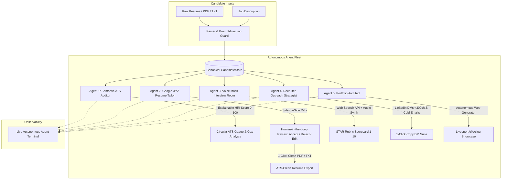

# 🚀 CareerPulse AI — Autonomous Hiring Readiness Copilot

[](https://unstop.com)
[](#)
[](https://aistudio.google.com)
[](https://opensource.org/licenses/MIT)

> **An Autonomous, Multi-Agent Career Platform powered by Google Gemini 2.5** bridging the fatal gap between resume ATS keyword screening and live technical interview job-readiness.

---

## 📌 Problem Statement & Grounding Research

According to the landmark **Harvard Business School study (*"Hidden Workers: Untapped Talent"*)**, **88% of enterprise employers** acknowledge that their Applicant Tracking Systems (ATS) filter out millions of highly qualified candidates due to rigid keyword matching, lack of quantified bullet achievements, and multi-column formatting misparses.

Existing tools (Jobscan, Teal, Rezi) stop at basic keyword stuffing. **CareerPulse AI** is an autonomous, 5-agent hiring readiness copilot that guides the candidate from semantic audit all the way to simulated voice mock interviews and personalized recruiter outreach.

---

## 🏛️ System Architecture



---

## ✨ The 5 Autonomous Agents

| Agent | Module Name | AI Core | Key Functionality |
|---|---|---|---|
| **Agent 1** | **Semantic ATS Auditor** | Gemini 2.5 Flash + Zod | Computes an **Explainable ATS Hiring Readiness Index (0–100)**: 40% Keyword Alignment + 25% Cosine Relevance + 15% Experience Match + 10% Google XYZ Achievement + 10% Layout Hygiene. Built-in **Prompt-Injection Sanitizer**. |
| **Agent 2** | **Google XYZ Resume Tailor** | Gemini 2.5 Flash | Converts passive bullets (*"worked on features"*) into quantified achievements (*"Accomplished [X] by doing [Y], resulting in [Z]"*). Provides human-in-the-loop **Accept / Reject / Customize** diffs. |
| **Agent 3** | **Voice Mock Interview Room** | Web Speech API + SpeechSynthesis + Gemini | Conducts live spoken mock interviews targeting detected skill gaps. Evaluates answers against the **STAR Rubric** (Situation, Task, Action, Result) with **Text Fallback Mode** for noisy environments. |
| **Agent 4** | **Recruiter Outreach Strategist** | Gemini 2.5 Flash | Drafts tailored LinkedIn connection notes (strict <300 char limit), cold recruiter emails with catchy subject lines, and keyword-optimized About sections. |
| **Agent 5** | **Live Portfolio Architect** | Next.js Dynamic Routing | Automatically synthesizes candidate resume experience into a high-converting, recruiter-ready live web portfolio at `/portfolio/[slug]`. |

---

## 🎨 Design Philosophy: Optimus Light Theme

- **Warm Alabaster Background:** `#fafaf9`
- **Architectural Blueprint Grid:** 1px subtle lines (`rgba(228, 228, 231, 0.45)`)
- **Typography:** JetBrains Mono for system metrics, telemetry, and tokens; clean sans for readability.
- **Card Styling:** 1px stone borders `#e7e5e4`, slate text `#1c1917`, soft status pills.
- **Live Observability Terminal:** Real-time log stream showing prompt sanitization, latency, and agent token footprints.

---

## 🛠️ Quickstart & Local Installation

### Prerequisites
- Node.js 18+ (tested on Node v25.5.0)
- npm 9+ (tested on npm 11.8.0)
- Google AI Studio API Key ([Get free Gemini key](https://aistudio.google.com/))

### 1. Clone & Install
```bash
git clone https://github.com/raghavsharma11248-sketch/CareerPusAI.git
cd CareerPusAI
npm install
```

### 2. Configure Environment (Optional)
```bash
cp .env.example .env.local
# Set your GEMINI_API_KEY in .env.local (or set it dynamically inside the web UI)
```

### 3. Run Development Server
```bash
npm run dev
```
Open **[http://localhost:3000](http://localhost:3000)** in your browser.

> 💡 **Hackathon Judge 1-Click Demo:** Click the **"1-Click Demo"** button in the top navigation bar to instantly preload a complete, realistic candidate profile (*Alex Chen — Senior Frontend Engineer @ Stripe*).

---

## 🔒 Security & Privacy Guardrails

1. **Prompt Injection Sanitizer:** Strips out adversarial instructions (`"ignore previous instructions"`, `"system:"`, `"you are now"`) before LLM ingestion.
2. **Workday & Greenhouse Hygiene Simulator:** Enforces single-column text layouts, preventing multi-column sequential parser breaks.
3. **Verified Candidate Domain Policy:** Only trusted email domains (`@gmail.com`, `@outlook.com`, `@yahoo.com`, `@icloud.com`) are permitted, blocking disposable/spam accounts.
4. **Client-Side Privacy:** API keys entered via the navbar settings modal are stored locally in the user's browser session.

---

## 👥 Hackathon Team & Track Information

- **Event:** HackNowa Global Hackathon 2026 (Unstop)
- **Track:** Future of Work & Automation
- **GitHub Repository:** [https://github.com/raghavsharma11248-sketch/CareerPusAI](https://github.com/raghavsharma11248-sketch/CareerPusAI)
